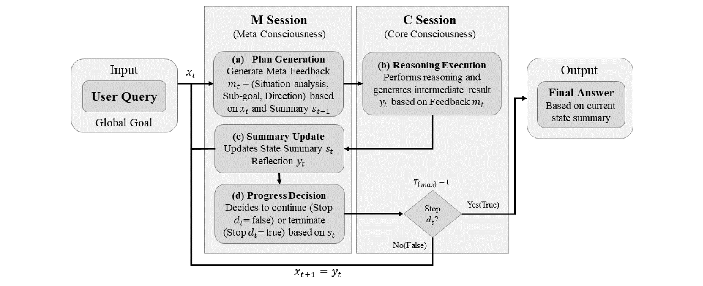
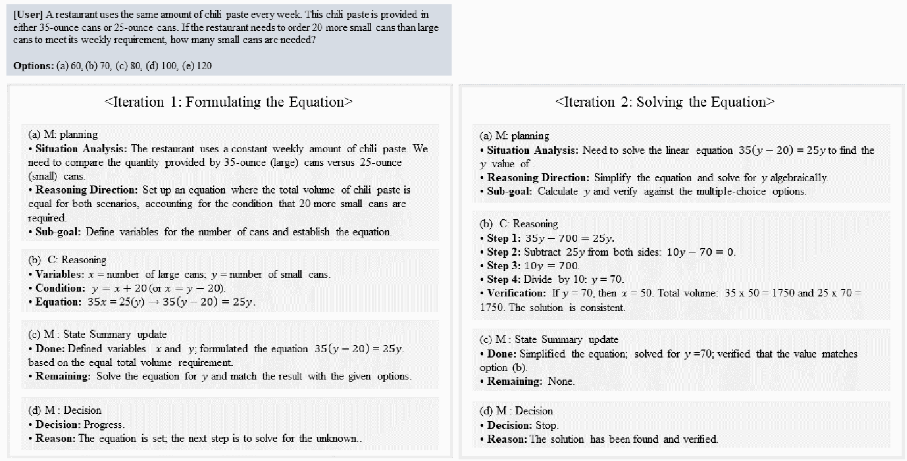

# Iterative Reasoning Framework for Large Language Models via Meta-Level Feedback

**메타 수준 피드백을 활용한 대형 언어 모델의 단계적 추론 프레임워크**

**이주영 · 안재균** · 인천대학교  
*Journal of KIISE (정보과학회논문지), 53(10), 1032–1040, 2026*

[](https://www.kci.go.kr/kciportal/ci/sereArticleSearch/ciSereArtiView.kci?sereArticleSearchBean.artiId=ART003394239)

**[Paper · KCI](https://www.kci.go.kr/kciportal/ci/sereArticleSearch/ciSereArtiView.kci?sereArticleSearchBean.artiId=ART003394239)**


## Abstract

Large Language Models (LLMs) have demonstrated strong performance on complex reasoning tasks, and various methods have been proposed to further improve their reasoning ability. Chain-of-Thought (CoT) has the limitation of error propagation along a single reasoning path, while self-consistency alleviates this issue but requires high computational cost. In addition, although recent commercial LLMs such as GPT-4o and GPT-5 exhibit enhanced reasoning performance, their reasoning processes are still carried out largely internally, making them difficult to observe and interpret. To address these limitations, this study proposes a iterative reasoning framework that separates a single LLM into a meta session and an execution session. The meta session monitors the current reasoning state and determines the goal and direction of the next step, while the execution session performs the actual reasoning accordingly. Through this design, the proposed framework improves the stability, controllability, and explainability of reasoning, and demonstrates superior performance over existing methods in multi-hop and causal reasoning tasks.

## Framework



*Figure 1. Overall framework of the proposed method.*

A single LLM serves as both the meta session (M) and execution session (C). The meta session plans the next sub-goal, summarizes the current state, and decides whether to continue. The execution session performs the corresponding reasoning. The resulting trace makes the planning, intermediate results, and termination decisions available for inspection.

## Reasoning Example



*Figure 2. Iterative reasoning example of the proposed framework on a MathQA problem.*

Both figures are extracted from the authors' manuscript. Publication details and the published article are available through the KCI link above.

## Citation

Bibliographic metadata follows the [KCI record](https://www.kci.go.kr/kciportal/ci/sereArticleSearch/ciSereArtiView.kci?sereArticleSearchBean.artiId=ART003394239).

```bibtex
@article{ART003394239,
  author  = {이주영 and 안재균},
  title   = {메타 수준 피드백을 활용한 대형 언어 모델의 단계적 추론 프레임워크},
  journal = {정보과학회논문지},
  year    = {2026},
  volume  = {53},
  number  = {10},
  pages   = {1032--1040},
  issn    = {2383-630X},
  url     = {https://www.kci.go.kr/kciportal/ci/sereArticleSearch/ciSereArtiView.kci?sereArticleSearchBean.artiId=ART003394239}
}
```

<details>
<summary><strong>Code and usage</strong></summary>

This release is extracted from the authors' original `dual_thinking_machine` source. It retains the original M/C system prompts, planning and reasoning prompts, state summaries, decision logic, final-answer extractor, and JSON parsing fallbacks. The core method is packaged for standalone Python use, with SQLite records of the reasoning chain.

| File | Purpose |
| --- | --- |
| `meta_feedback/orchestrator.py` | Original M/C reasoning loop and step events |
| `meta_feedback/prompts.py` | Original system and task prompts, including final-answer extraction |
| `meta_feedback/llm_runtime.py` | Original shared GGUF runtime and response parsing |
| `meta_feedback/sqlite_store.py` | Reasoning-chain nodes, links, and session logs |
| `meta_feedback/schemas.py` | Structured responses and trace schemas |
| `meta_feedback/config.py` | Portable model settings |
| `run.py` | Single-question command-line entry point |

The release uses the original experiment path with role-specific KV persistence disabled. The original `chatml` message format and raw-text fallbacks are preserved. Full traces are stored separately; subsequent planning uses the previous reasoning output and the updated summary.

### Quick Start

Use Python 3.9 or later and an instruction-tuned GGUF model compatible with the source runtime's `chatml` format.

```bash
python -m venv .venv
source .venv/bin/activate
pip install -r requirements.txt

python run.py \
  --model /path/to/model.gguf \
  --question "Alice has 3 apples and buys 2 more. How many apples does she have?" \
  --output outputs/example.json
```

For an NVIDIA CUDA build, install the backend using:

```bash
CMAKE_ARGS="-DGGML_CUDA=on" pip install --upgrade --force-reinstall -r requirements.txt
```

Use `--n-gpu-layers 0` for CPU inference or `--gpu 0` to select a CUDA device. See the [llama-cpp-python installation documentation](https://llama-cpp-python.readthedocs.io/en/latest/) for platform-specific setup.

Defaults follow the supplied source settings: `--max-steps 3`, `--max-tokens 2048`, `--temperature 0.1`, `--top-p 0.95`, `--top-k 40`, `--repeat-penalty 1.1`, and `--n-ctx 15000`. Use `--max-steps 4` for a four-step limit. These are source-code defaults, not a claim that all published experiments used the same settings.

The command prints the final answer. SQLite logs are saved to `outputs/reasoning.db` (`--db` to change the path); `--output` additionally exports the run as JSON. `--answer-format` passes an optional answer constraint to the original extractor. Run `python run.py --help` for all options.

### Release Adjustments

Package imports, model paths, and the command-line entry point were adapted for standalone use. Integration fixes correct the initial chain link, previous-summary logging, the completed-step count and final link at the iteration limit, propagation of the answer format at forced termination, and explicit zero-temperature overrides. CUDA device selection now precedes the native backend import. Prompt text and the core plan → reason → summarize → decide sequence are preserved.

The tests exercise the original runtime, parsing, orchestration, CLI, and SQLite storage with scripted model outputs. Native GGUF inference and the published benchmark scores have not been revalidated in this release.

The control-flow tests run without a model or GPU:

```bash
python -m unittest discover -s tests -v
```

</details>
